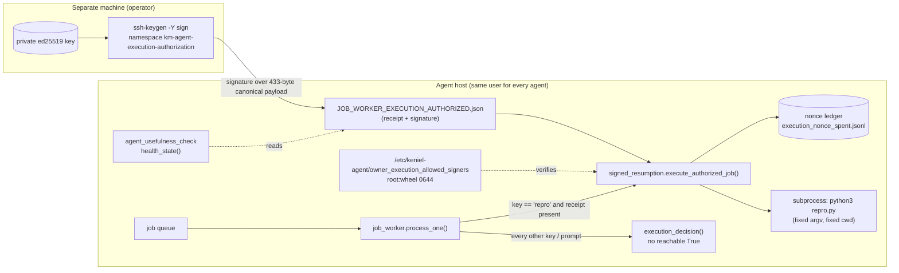
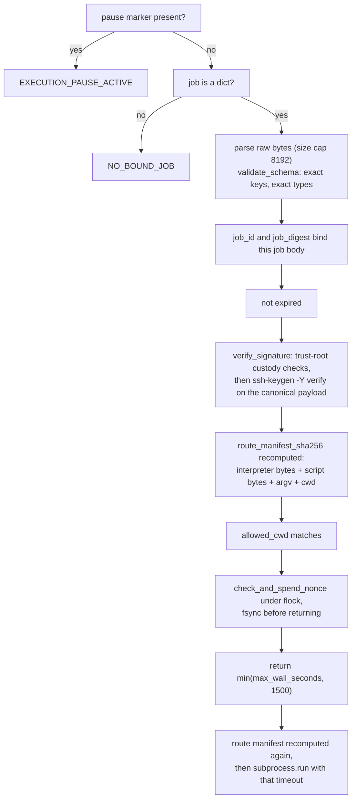
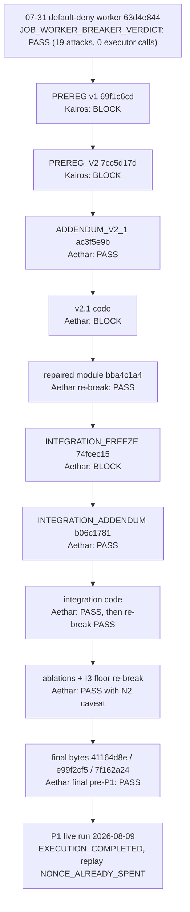

# Architecture of the bundle

This repository is an evidence bundle, not an application. Nothing here is meant to be
installed or deployed. It contains the code that ran, the contracts it was built against, the
reviews it passed and failed, and the receipts from one live run. This page explains how those
pieces fit together. Where it summarises a document, the document wins.

## The system the evidence is about

A job worker (`job_worker.INTEGRATED.py`) polls a job queue on the operator's Mac and could, in
earlier versions, run allowlisted commands or a headless coding agent. It was first repaired into
total default-deny (`job_worker.PRE_INTEGRATION_63d4e844.py`, reviewed on 2026-07-31). The
signed-resumption work then opened exactly one position: the `repro` route, reachable only with a
receipt signed by an operator key that no agent on the machine holds.

Files in this repository that correspond to the boxes:

| Box | File here |
|---|---|
| worker | `job_worker.INTEGRATED.py` (the live worker, byte for byte) |
| verifier / executor boundary | `signed_resumption.py` |
| health checker | `agent_usefulness_check.INTEGRATED.py` |
| public half of the trust root | `owner_execution_allowed_signers` |
| receipt, ledger, refusal, log | `p1_receipts/` |

The worker loads `signed_resumption.py` by absolute path and refuses unless its SHA-256 equals
the reviewed digest (`job_worker.INTEGRATED.py`, `_load_signed_resumption`). The checker imports
the same module so there is one signature policy, not two.

## The one decision, in order

`signed_resumption.authorize()` is called once, inside `execute_authorized_job()`, immediately
before the subprocess. The order is part of the contract (PREREG_V2 K2 to K4, ADDENDUM_V2_1 R1 to
R5):

Any failed step raises `Refusal(<CODE>)` and nothing executes. The nonce is spent last among the
checks so a refusal never consumes it, and before the executor so a crash cannot cause a second
run (at-most-once is the frozen trade).

## Canonical payload

The signature covers the receipt minus `signature`, serialised as UTF-8 JSON with sorted keys,
`separators=(",", ":")`, no trailing newline (`signed_resumption.canonical_payload`). For the P1
receipt that is 433 bytes with SHA-256 `4ed5ecff...6b64f`. [VERIFY.md](../VERIFY.md) rebuilds it
and checks the signature with stock OpenSSH.

## How the evidence was produced

Contracts were written and hashed first, then reviewed by a seat that did not write them, then
implemented, then the code was reviewed, then the live run happened. Each verdict file names the
exact digests it reviewed.

The four BLOCK verdicts are kept on purpose. The README's "Limits" section and the contracts'
"How this can come out wrong" and "Scope limits" sections state what the result does not cover
(same-user host integrity, a user-writable spend ledger, the hash-to-exec interval, and key
custody being an operational claim).

## The harnesses

The `ABLATION_*.py` and `I3_REGRESSION_FLOOR_HARNESS_*.py` files are the maker's harnesses as they
were run. Each ablation removes one protection from a temporary copy of the module or worker and
requires the paired attack to flip from refused to allowed. They read their inputs from absolute
paths on the author's machine (`/Users/kenielmaldonado/...`), so they do not run unmodified
anywhere else, and the I3 floor harness asserts a worker digest (`df506897...`) that is an
intermediate build not included in this bundle. The final pre-P1 verdict reports the same 19
cases on the shipped worker `e99f2cf5...` using its own harness, which is also not included.
The committed harnesses are evidence and are not edited.
